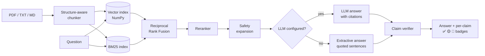

<div align="center">

# ⚕️ CiteRx

### Clinical answers you can verify, one claim at a time.

Ask questions about clinical guidelines, discharge summaries and lab reports.<br>
Every answer is cited, every sentence is checked against its source, and every invented number is caught.


</div>

---

## Why CiteRx

Most RAG demos stop at "the model added citations". In clinical text that isn't enough: a model can cite the right page and still change **1000 mg** to **1500 mg**. CiteRx treats the citation as a claim to be checked, not a decoration.

| Problem in clinical RAG | What CiteRx does |
|---|---|
| The LLM invents a dose or threshold | **Numeric grounding**: any number in a claim that isn't in the cited source flags the claim, whatever its wording |
| A fact is cited to the wrong passage | **Claim-level verification** against the *cited* passage only, not the whole context |
| A dose is retrieved without its warning | **Safety expansion** pulls WARNING/CAUTION passages from the same section into the context |
| Chunking separates a warning from its dosage | **Structure-aware chunking** fuses safety blocks with what they refer to, and never crosses a heading |
| Keyword *or* semantic search misses things | **Hybrid retrieval**: BM25 + dense vectors, merged with Reciprocal Rank Fusion, then reranked |
| Quality silently regresses | **CI quality gate**: tests and an evaluation suite run on every push and block a regression |

It also runs with **no LLM at all**: extractive mode answers by quoting source sentences with citations, so the app works offline on a laptop and CI needs no model downloads.

## How it works



1. **Chunking** (`citerx/ingest/chunker.py`) detects Markdown, numbered (`4.1 Dosage`), ALL-CAPS and Title Case headings. Paragraphs are packed up to ~1,100 characters within a section. A block starting with WARNING, CAUTION, CONTRAINDICATED, DO NOT, etc. is fused with its neighbour and never split.
2. **Indexing** (`citerx/index/`) stores normalised embeddings in a NumPy matrix (exact search, no database to run) and builds a BM25 index with a tokenizer that keeps clinical tokens like `140/90`, `mL/min` and `1.73` intact.
3. **Retrieval** (`citerx/retrieve/`) takes the top 15 from each retriever, fuses them with RRF (k=60), reranks the top 10 and keeps 5. Warnings from the same sections are then added if missing.
4. **Generation** (`citerx/generate/`) sends numbered sources to any OpenAI-compatible endpoint (Ollama, Groq, vLLM...) with strict citation rules, or answers extractively. If the LLM is unreachable, CiteRx falls back to extractive mode instead of failing.
5. **Verification** (`citerx/verify/claims.py`) splits the answer into claims and scores each one against the passages it cites:

| Status | Meaning |
|---|---|
| ✅ supported | ≥ 60% of the claim's content words appear in a one- or two-sentence window of a cited passage, and every number matches |
| 🟡 weak | 35–60% word support: read the source |
| 🔴 unsupported | low support, a wrong citation, or **any number missing from the cited source** |
| ⚪ uncited | no citation given |

```text
Answer:  Do not exceed 1500 mg per day when eGFR is between 30 and 45 [1].
Source:  ...do not exceed 1000 mg per day.
Result:  🔴 unsupported · support 78% · numbers not in source: 1500
```

## Quick start

```bash
git clone https://github.com/<your-username>/citerx.git
cd citerx
python -m venv .venv && source .venv/bin/activate   # Windows: .venv\Scripts\activate
pip install -r requirements.txt

streamlit run app/streamlit_app.py
```

Open http://localhost:8501. Three sample documents are indexed on first run, so you can ask questions straight away.

### Add an LLM (optional)

```bash
# Fully offline with Ollama
ollama pull qwen3
export CITERX_LLM_BASE_URL=http://localhost:11434/v1
export CITERX_LLM_MODEL=qwen3:latest

# Or a hosted OpenAI-compatible API such as Groq
export CITERX_LLM_BASE_URL=https://api.groq.com/openai/v1
export CITERX_LLM_MODEL=llama-3.3-70b-versatile
export CITERX_LLM_API_KEY=gsk_...
```

### Better retrieval (optional)

```bash
pip install -r requirements-neural.txt
```

This enables `all-MiniLM-L6-v2` embeddings and the `ms-marco-MiniLM-L-6-v2` cross-encoder. Without it CiteRx uses a lightweight hashed n-gram embedder and a term-coverage reranker, and the active backends are always shown in the app and in evaluation reports.

### Command line

```bash
pip install -e .
citerx ingest samples/*
citerx ask --sources "What are the renal contraindications for metformin?"
citerx eval
```

### Deploy to Streamlit Community Cloud

Point a new app at `app/streamlit_app.py`. To use an LLM, add `CITERX_LLM_BASE_URL`, `CITERX_LLM_MODEL` and `CITERX_LLM_API_KEY` under **Settings → Secrets**; without them the app runs in extractive mode.

## Evaluation

`python -m citerx.eval.run` ingests the sample documents, answers 18 questions (16 answerable, 2 out of scope) and fails if any metric falls below its gate.

| Metric | What it measures | Gate | Extractive mode* |
|---|---|---|---|
| hit@k | Expected section is among the retrieved sources | 0.90 | 1.000 |
| MRR | How high the expected section ranks | 0.75 | 0.969 |
| Fact recall | Required facts (doses, thresholds) present in the answer | 0.80 | 1.000 |
| Groundedness | Claims verified against their cited source | 0.90 | 1.000 |
| Abstention accuracy | Answers in-scope questions, declines out-of-scope ones | 0.90 | 1.000 |
| Safety recall | Warning-bearing questions get their warning | 0.80 | 1.000 |

\* Fallback embedder and reranker, no LLM. The test set is small and hand-written for the bundled samples: it is a regression gate, not a benchmark. Extractive answers quote the source, so perfect groundedness is expected there; the verifier matters most in LLM mode (`--llm`), where the unit tests show it catching an invented dose.

## Project structure

```text
citerx/
├── citerx/
│   ├── ingest/      loaders.py (PDF/TXT/MD) · chunker.py (structure-aware)
│   ├── index/       embedder.py · bm25.py · store.py (persistent index)
│   ├── retrieve/    fusion.py (RRF) · reranker.py · retriever.py (funnel + safety expansion)
│   ├── generate/    prompts.py · llm.py (OpenAI-compatible) · extractive.py
│   ├── verify/      claims.py (claim-level + numeric grounding)
│   ├── eval/        dataset.json · run.py (metrics + quality gate)
│   ├── pipeline.py  CiteRx().ingest(path) / CiteRx().ask(question)
│   └── cli.py
├── app/streamlit_app.py
├── samples/         synthetic guideline, pathway and discharge summary
├── tests/           23 unit and integration tests
└── .github/workflows/ci.yml
```

## Tests

```bash
pip install -r requirements-dev.txt
pytest -q
```

The tests cover warning/dosage fusion, section boundaries, BM25 on clinical tokens, RRF, safety expansion, invented doses, wrong citations, uncited claims, LLM failure fallback, and reasoning-tag stripping for models like qwen3.

## Limitations and roadmap

- The verifier is lexical. It catches invented numbers, wrong citations and unsupported wording, but it can't detect a negation flip ("do" vs "do not") that reuses the source's words. **Next:** add an optional NLI model as a third check.
- Scanned PDFs need OCR before ingestion.
- Tables in PDFs are read as text, so row and column structure is lost.
- **Next:** section-aware answer highlighting in the Browse tab, and a larger evaluation set built from public guidelines.

## Disclaimer

CiteRx is a portfolio and research project, not a medical device. The bundled documents are synthetic samples written for the demo and are not clinical guidance.

## Acknowledgements

The problem framing was inspired by [MedCite](https://github.com/likitha-shankar/Medcite) by Likitha Shankar. CiteRx is an independent implementation.

## License

MIT © 2026 Amogh Athreya H
